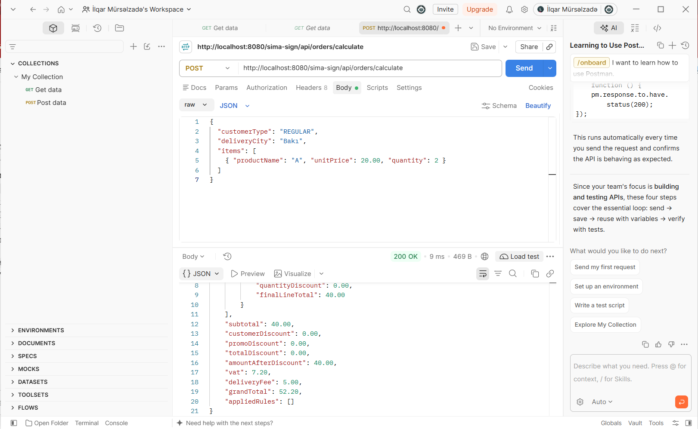
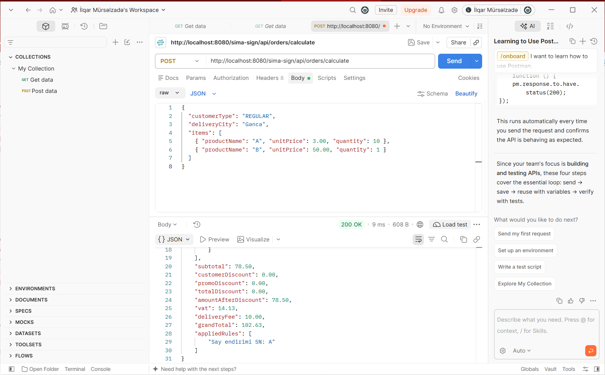
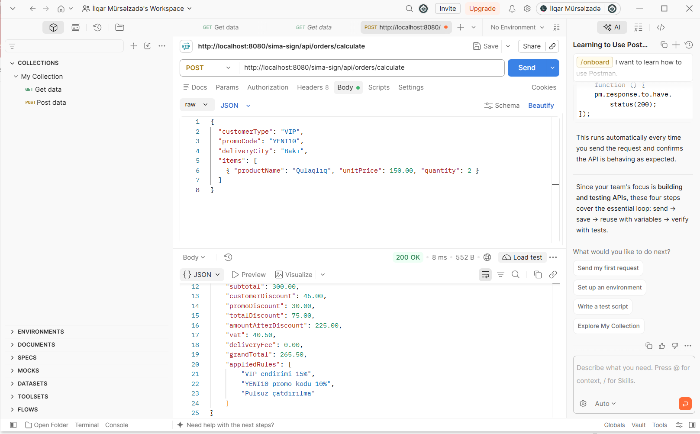
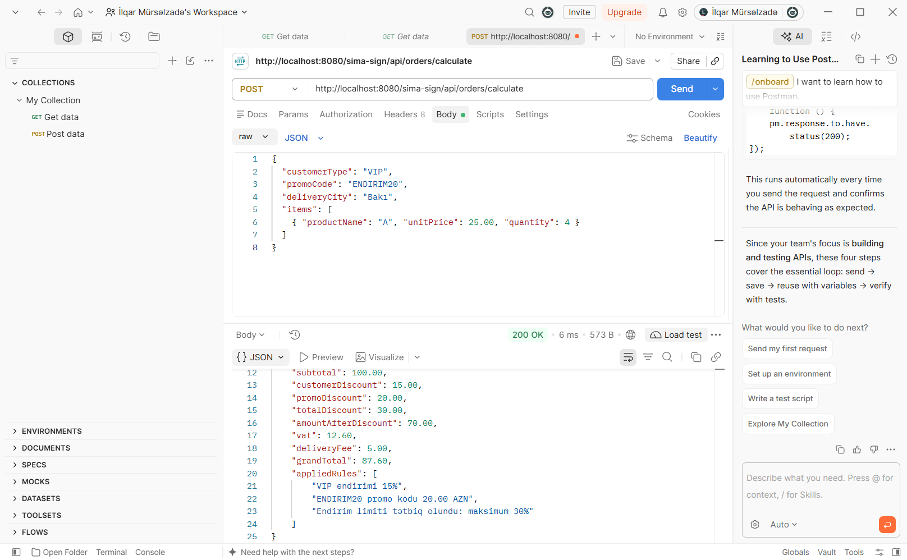
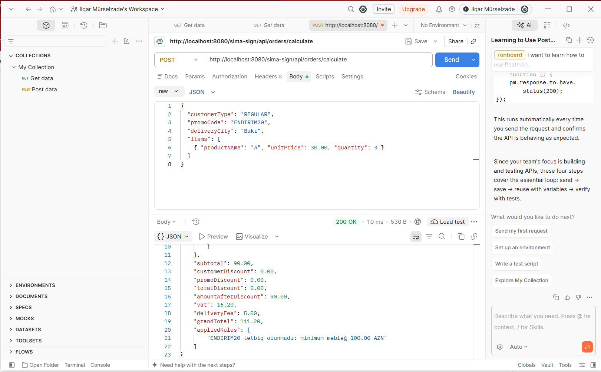
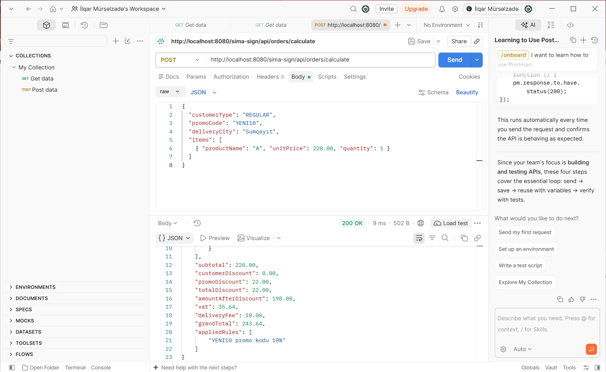
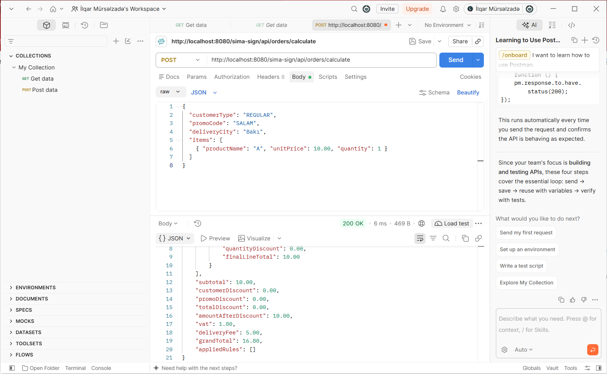
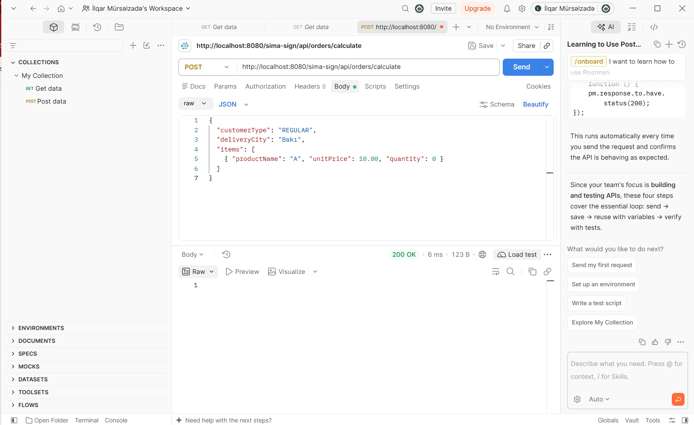

# Sifariş Hesablama API

Java 25, Spring Boot 3.5

## İşə salmaq
`mvn spring-boot:run` və ya IntelliJ-də `SimasignApiApplication` sinfini Run edin.

Endpoint: `POST http://localhost:8080/sima-sign/api/orders/calculate`

## Ssenarilərin nəticəsi

### Ssenari 1

### Ssenari 2

### Ssenari 3

### Ssenari 4

### Ssenari 5

### Ssenari 6

### Ssenari 7

### Ssenari 8

